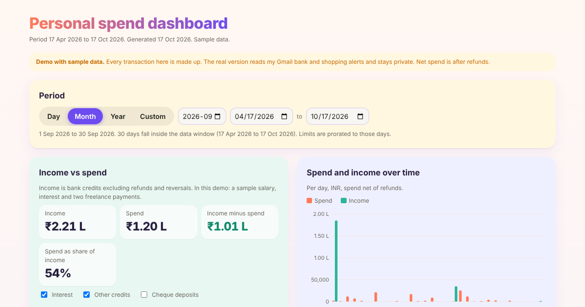

# AI-agent spend dashboard (demo)

Live demo: https://spend-dashboard-demo.vercel.app

A pipeline of AI agents that turns bank and shopping alerts in a mailbox into a KPI dashboard.
This repository holds the public demo, which runs on **generated sample data only**. The private version reads real Gmail alerts.

## What it does
- **Agent 1 / 1b** read transaction and income alerts (read-only) and write one clean row each.
- **Agent 2 / 2b** remove duplicates, pair refunds with orders, assign 11 budget categories and find subscriptions.
- **Agent 3** builds this static dashboard.
- A scheduled task re-runs the pipeline every Monday.

## Dashboard features
- North-star metric: everyday spend per month, with a month-over-month change
- 11 category limits with over-limit indicators
- Income vs spend by day, month, year or custom range
- Six savings levers computed from the data

## Files
- `index.html`: the built dashboard (single file, d3 from a CDN)
- `gen.py`: generates the sample transactions and income
- `agents/agent_3_build_dashboard.py`, `agents/agent_3_page.html`: dashboard builder and page template

Built with Claude (agents, Gmail connector, scheduled tasks), Python, d3 and Vercel.
